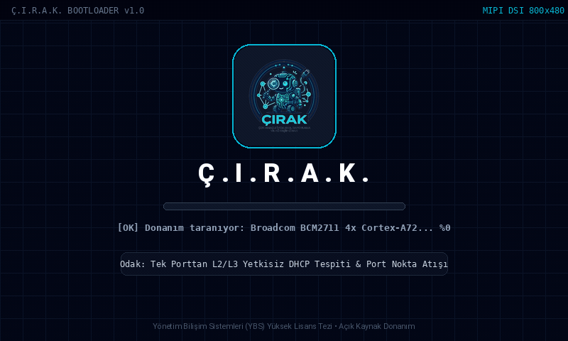

<div align="center">


# Ç.I.R.A.K.
### Çok Amaçlı İnceleme, Raporlama ve Ağ Keşif Cihazı
**Akıllı, Taşınabilir Ağ Analiz ve Yetkisiz (Rogue) DHCP Tespit El Terminali**

[](https://www.python.org/)
[](https://wiki.qt.io/Qt_for_Python)
[](https://www.raspberrypi.com/)
[](https://www.raspberrypi.com/products/raspberry-pi-touch-display/)

<br/>



<br/><br/>

[**🇹🇷 Türkçe**](#-türkçe-açıklama) &nbsp;|&nbsp; [**🇬🇧 English**](#-english-summary)

---

</div>

<a name="-türkçe-açıklama"></a>
## 🇹🇷 Türkçe Açıklama

**Ç.I.R.A.K.** (*Çok Amaçlı İnceleme, Raporlama ve Ağ Keşif Cihazı*), **Yönetim Bilişim Sistemleri (YBS) Yüksek Lisans Tezi** kapsamında geliştirilmekte olan açık kaynaklı, bağımsız, taşınabilir bir ağ analiz ve arıza tespit el terminalidir. 

Saha operasyonlarında sistem ve ağ yöneticilerine saniyeler içinde L1-L7 katmanlarında tam teşhis, yetkisiz (Rogue) DHCP tespiti ve ağ haritalama imkanı sunar.

---

### 🎯 Çekirdek Odak: Yetkisiz (Rogue) DHCP Tespiti ve Port İzolasyonu
Projenin en kritik özgün katkısı, kurumsal yerel ağlarda (LAN) hizmet kesintilerine yol açan sahte modem ve yetkisiz DHCP sunucularının tek port üzerinden hızla tespit edilmesidir:
* **Çift Porta Gerek Duymayan Dinleme:** Fiziksel hat arasına girmeden, tek Gigabit Ethernet portu (`eth0`) üzerinden `DHCP Discover` yayınlarıyla sahte sunucuları yakalar.
* **SNMP ile Anahtar Portu Nokta Atışı:** Sahte cihazın MAC adresi belirlendikten sonra, SNMP `BRIDGE-MIB` sorguları ile sahte yayının bağlı olduğu kurumsal anahtar (switch) ve fiziksel erişim portu saniyeler içinde bulunur.

---

## ⚡ Temel Özellikler

1. **⚡ Otomatik Test (AutoTest L1 - L7):** 
   - 10 saniyede fiziksel link (hız, dubleks, MDIX), LLDP/CDP anahtar/port/VLAN, DHCP IP kiralama, varsayılan ağ geçidi ping & ARP MAC, kampüs içi DNS sorgusu ve dış ağ HTTP doğrulaması.
2. **🔍 Ağ Keşfi & Teşhis Araçları:**
   - **LLDP / CDP Paket Dinleyicisi:** Switch adı, port kimliği, yerel VLAN ve yönetim IP'sini yakalar.
   - **Port Işıkları (Flaşör):** Switch port LED'ini periyodik yakıp söndürerek kabinet kablolama takibini kolaylaştırır (`ethtool --identify`).
   - **Alt Ağ IP Doluluk (Hızlı ARP Sweep):** Aktif alt ağdaki IP doluluk oranını ve cihaz envanterini listeler.
3. **🚨 Yetkisiz DHCP Tespiti (Rogue DHCP Hunter):**
   - Ağdaki yetkisiz DHCP tekliflerini yakalar ve onaylı sunucu listesiyle karşılaştırarak anında alarm üretir.
4. **🚀 Hız Testi (iPerf3):**
   - Ağ geçidine veya yerel iPerf3 sunucusuna 1 Gbps hat hızında throughput, gecikme ve jitter ölçümü yapar.
5. **📶 Kablosuz Ağ Analizi:**
   - 2.4 / 5.0 GHz kablosuz ağlarda SSID, sinyal seviyesi (RSSI / dBm) ve kanal yoğunluğunu listeler.
6. **⚙️ Çift Tema & Dokunmatik Ergonomi:**
   - 7 inç 800×480 dokunmatik ekran için optimize edilmiş 240×160 px butonlar.
   - **Karanlık Mod (Dark Industrial - #020617)** ve **Aydınlık Mod (Light Industrial - #f8fafc)** destekli tema motoru.

---

## 🛠 Donanım & Sistem Mimarisi

* **Ana İşlemci Birimi:** Raspberry Pi 4 Model B (Broadcom BCM2711, Quad-core Cortex-A72 @ 1.5GHz)
* **İşletim Sistemi:** Raspberry Pi OS Lite (Debian Bookworm tabanlı)
* **Ekran:** Resmi Raspberry Pi 7" Kapasitif Dokunmatik Ekran (800×480 @ 60Hz, MIPI DSI)
* **Fiziksel Ağ Portu:** 10/100/1000 Gigabit Ethernet (eth0 - Broadcom BCM54213PE PHY)
* **Kablosuz Ağ:** Onboard 2.4/5.0 GHz IEEE 802.11ac Wi-Fi
* **Güç & Batarya:** 5.1V / 3A USB-C PD veya batarya yönetim şapkası

---

## 📐 Yazılım & Modül Yapısı

```
cirak/
├── app.py                   # PySide6 uygulama giriş noktası
├── config.py                # Ekran çözünürlüğü, renkler, zaman aşımları ve profiller
├── core/                    # Temel veri modelleri ve asenkron sinyal yapısı
│   ├── models.py            # TestResult, NetworkStatus, DHCPInfo, LLDPInfo veri sınıfları
│   ├── signals.py           # Qt Signal/Slot yöneticisi
│   └── worker.py            # QRunnable / QThreadPool arka plan iş parçacığı yöneticisi
├── backend/                 # Ağ teşhis motoru ve test fonksiyonları
│   ├── base.py              # TestBase soyut taban sınıfı
│   ├── physical_link.py     # L1: Link hızı, dubleks, carrier ve sayaçlar
│   ├── lldp_cdp.py          # L2: LLDP ve CDP paket yakalama & ayrıştırma
│   ├── dhcp.py              # L3: DHCP işlem zamanı, lease ve Rogue DHCP tespiti
│   ├── ping.py              # L3: Ağ geçidi ping ve ARP MAC çözümleme
│   ├── dns_test.py          # L7: DNS çözümleme gecikmesi ve sunucu testi
│   ├── external_test.py     # L7: Dış ağ erişilebilirlik ve HTTP 200 doğrulaması
│   ├── autotest.py          # L1-L7 tam zincir orkestratörü
│   ├── port_blinker.py      # Switch port LED flaşörü (ethtool blink)
│   ├── arp_scanner.py       # Alt ağ hızlı ARP tarayıcısı
│   ├── iperf_runner.py      # iPerf3 throughput / jitter istemcisi
│   └── wifi_scanner.py      # Kablosuz ağ arayüzü taraması
└── gui/                     # 800x480 dokunmatik arayüz bileşenleri
    ├── theme.py             # Aydınlık / Karanlık QSS tema paleti
    ├── main_window.py       # Sabit 800x480 ana pencere ve sayfa yönlendiricisi
    ├── components/          # Üst durum çubuğu, alt bilgi çubuğu, dokunmatik butonlar
    └── views/               # Ana menü, AutoTest, Keşif, Rogue DHCP ve Açılış ekranları
```

---

<a name="-english-summary"></a>
## 🇬🇧 English Summary

**Ç.I.R.A.K.** (*Multi-Purpose Inspection, Reporting, and Network Discovery Instrument*) is an open-source, handheld network diagnostic device developed as part of a Master's thesis in Management Information Systems.

### Key Highlights
* **Single-Port Rogue DHCP Hunting:** Detects unauthorized DHCP offers and pinpoints the offending switch port using SNMP `BRIDGE-MIB` queries without requiring dual-port taps.
* **10-Second AutoTest:** Automated verification of Physical Link, LLDP/CDP switch port identity, DHCP allocation, gateway ping, DNS resolution, and WAN access.
* **Layer 2 Discovery:** Real-time decoding of LLDP and CDP frames for instantaneous VLAN and switch mapping.
* **Line-Rate Throughput Testing:** Evaluates line throughput and jitter with iPerf3 up to 1 Gbps.
* **Wireless Environment Survey:** Scans 2.4/5.0 GHz networks for SSID, signal strength (dBm), and channel crowding.
* **Low-Footprint Operation:** Runs natively on Raspberry Pi OS Lite via DRM/KMS (EGLFS), ensuring cold-boot readiness within seconds.

---

## 🚀 Kurulum ve Çalıştırma

### Bağımlılıkların Yüklenmesi
```bash
# Python sanal ortamı oluşturma
python3 -m venv .venv
source .venv/bin/activate

# Paketleri yükleme
pip install -r requirements.txt
```

### Testleri Çalıştırma
```bash
pytest -v
```

### Arayüzü Başlatma
```bash
# Geliştirme ortamında çalıştırma
python -m cirak.app

# Raspberry Pi üzerinde EGLFS / Linux DRM ile çalıştırma (X11 olmadan)
QT_QPA_PLATFORM=eglfs python -m cirak.app
```

---

## 📄 Lisans
Bu proje YBS Yüksek Lisans Tezi araştırması kapsamında geliştirilmektedir. Tüm hakları saklıdır.
