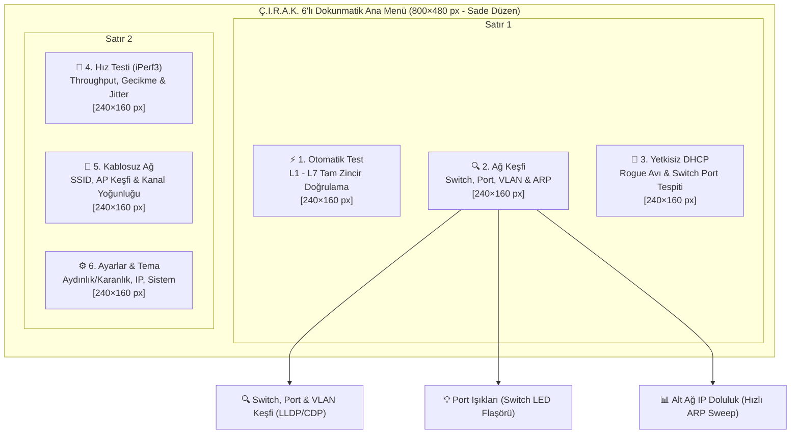

# Ç.I.R.A.K. El Terminali 7" Dokunmatik Arayüz ve Mimari Şartnamesi (Nihai Revizyon)

> [!IMPORTANT]
> **Proje Kapsamı ve Nihai Donanım:**  
> YBS Yüksek Lisans Tezi kapsamında geliştirilen **Ç.I.R.A.K.** (*Çok Amaçlı İnceleme, Raporlama ve Ağ Keşif Cihazı*) el terminali; **Raspberry Pi 4 Model B (Raspberry Pi OS Lite)** ve **7 inç Resmi Kapasitif Dokunmatik Ekran (800×480 piksel, MIPI DSI)** üzerinde çalışacaktır. Arayüz dili, Fluke LinkRunner serisinin endüstriyel kararlılığını modern dokunmatik ergonomisiyle harmanlar.

---

## 1. Onaylanan 6'lı Ana Menü Mimarisi (2 Satır × 3 Sütun)

Gereksiz rozetler (`<10 sn`, `★ Tez Katkı` vb.) tamamen kaldırılmış; odak yalnızca **ikon**, **büyük başlık** ve **net açıklama satırına** verilmiştir.

### Düğme Hiyerarşisi ve Dokunma Alanları
* **Dokunma Alanı (Touch Target):** Her bir buton **240 × 160 piksel** büyüklüğündedir. Minimum dokunmatik standardı olan 48×48 pikselin tam 5 katıdır. Tek elle veya koruyucu eldivenle dahi sıfır hata payı sağlar.
* **Tipografi:** Başlıklar daha büyük ve belirgin (`text-lg font-extrabold`), alt açıklamalar net ve okunabilir (`text-xs font-medium`).
* **Keşif Alt Menüsü:** "Port Işıkları / Flaşör" ve "Alt Ağ ARP Taraması" araçları "Ağ Keşfi" butonunun altında yer alarak ana menüyü ferah ve amaca yönelik tutar.

---

## 2. Sabit Durum Çubukları (Status Bars) Anatomisi

### A. Üst Durum Çubuğu (Top Status Bar - 40 px)
Metin kalabalığından arındırılmış, salt endüstriyel ikonlarla tasarlanmış üst gösterge:
1. **Sol Kısım:**
   * **ÇIRAK Logosu:** Beyaz zeminli resmi amblemin kendisi (Aydınlık modda orijinal beyaz zemin, karanlık modda ise logonun çizim ve tipografisi birebir korunarak zemin koyu temaya uyarlandı).
   * **Cihaz Adı:** `Ç.I.R.A.K.` (Cyan / Koyu Lacivert).
   * **Aktif Profil:** `Profil: Kampus-Dinamik-DHCP` (Amber / Kahverengi).
2. **Sağ Kısım:**
   * **Ethernet Link (eth0):** Uluslararası kabul görmüş standart **Ethernet Port / 3-Düğümlü Ağ İkonu** (*Wikimedia Commons Ethernet_Port.svg*). Fiziksel link varsa **Sabit Canlı Yeşil**; kablo takılı değilse **Sabit Kırmızı**. Dikkat dağıtıcı yanıp sönme (blink) tamamen kaldırıldı.
   * **Wi-Fi Durumu:** Yanında yazı ("KALFA" vb.) yok; **Sabit Renkli Wi-Fi Sinyal İkonu**. Eduroam kampüs ağına bağlılığı gösterir.
   * **Güç Katmanı:** **Şimşek / Elektrik Güç İkonu** (`5.1V %94`).
   * **Dijital Saat:** `14:32` (Sistem odası test kayıtları için monospace canlı saat).

### B. Alt Durum Çubuğu (Bottom Quick-Info Bar - 42 px)
* **Sol Kısım:** `Son Keşif: SW-KAT2-KENAR03 • Port: Gi1/0/18 (VLAN 102)` (Bağlı olunan aktif switch kimliği).
* **Sağ Kısım:** `IP: 10.20.102.45/24` (Alınan dinamik IP ve maske).

---

## 3. Aydınlık ve Karanlık Tema Uyumluluğu (Dual-Theme Engine)

| Arayüz Katmanı | Karanlık Mod (Dark Industrial - Varsayılan) | Aydınlık Mod (Light Industrial / White Paper) |
| :--- | :--- | :--- |
| **Ana Zemin** | `#020617` (Deep Obsidian Black) | `#f8fafc` / `#ffffff` (Clean Slate White) |
| **Kart Zeminleri** | `#0f172a` (Koyu Lacivert) / Kenar: `#334155` | `#ffffff` (Saf Beyaz) / Kenar: `#cbd5e1` |
| **Metin Renkleri** | Başlık: `#ffffff` &bull; Açıklama: `#94a3b8` | Başlık: `#0f172a` &bull; Açıklama: `#475569` |
| **ÇIRAK Logosu** | Birebir aynı logo (Arka planı `#0f172a` olarak uyarlandı) | Orijinal beyaz zeminli ÇIRAK amblemi |
| **Durum İkonları** | Sabit Zümrüt Yeşili (`#10b981`) / Kırmızı (`#ef4444`) | Sabit Zümrüt Yeşili (`#059669`) / Kırmızı (`#dc2626`) |

---

## 4. Yazılım Framework Tercihi: PyQt6 / PySide6 (Native Python GUI)

* **RAM Kullanımı:** Boşta sadece **~35 – 55 MB** (Chromium Kiosk'un 350 MB'lık yüküne kıyasla 10 kat daha hafif).
* **CPU Yükü:** Boşta <%1 CPU; donanım hızlandırmalı OpenGL/EGL.
* **Boot Süresi:** Linux DRM/KMS Framebuffer (EGLFS) üzerinden masaüstü pencere yöneticisi olmadan doğrudan **3–5 saniyede** ekrana gelir.
* **Ağ Entegrasyonu:** Python `Scapy`, `pysnmp`, `netifaces`, `ethtool` ve `iperf3` arka plan iş parçacıkları (`QThread`) doğrudan `Signal/Slot` ile gecikmesiz haberleşir.

---

## 5. Açılış Ekranı (Boot / Splash Screen) Standardı

Cihaz adaptöre takıldığında veya bataryadan açıldığında doğrudan ekrana gelen minimalist açılış arayüzü:
* **Görsel:** 144×144 px büyük resmi ÇIRAK logosu (temaya uyarlanmış).
* **Başlık:** `Ç.I.R.A.K.` (Tok ve net tipografi).
* **İlerleme Göstergesi:** Donanım ve ağ sürücülerinin kontrolünü gösteren yatay akıcı bar.
* **Durum Metni:** `Modüller yükleniyor: eth0 gigabit PHY hazır...`
* **Gereksiz Öğeler:** Cihaz özellikleri, donanım spekleri veya sloganlar kaldırılmış; saf endüstriyel ciddiyet korunmuştur.
